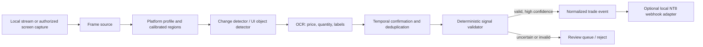

# Stream Signal Vision

**A modular computer-vision research prototype for recognizing trade events shown on livestream trading platforms.** It aims to turn a visible entry, stop, target, or exit into a validated structured event. The current repository is a tested foundation for ingestion, normalization, temporal confirmation, and safe output—not a trained vision model and not a live trading application.

Target interfaces under investigation: **TopstepX** (the Topstep platform), **TradingView**, **Tradovate**, **WealthCharts**, and **MetaTrader 5**. Each platform and streamer layout needs a calibrated profile; this project does not claim one model works zero-shot on every screen.

## Why this project

Some traders communicate through what they do on stream rather than explicit text alerts. A viewer may see an entry marker appear, quantity change, or stop/target line move. This project explores how to detect those visual state transitions, extract the displayed levels, validate them, and emit a normalized signal.

The intended downstream contract is platform-neutral JSON (or a local webhook adapter). It can later feed the existing Discord-to-NT8 execution node; this repository deliberately contains no private Discord credentials, account configuration, provider screenshots, or order-execution code.

## Current status

- **Implemented and tested:** signal schema, trade-level validation, multi-frame confirmation/deduplication, adapter interfaces, and a local-webhook output adapter.
- **Not yet implemented:** live stream capture, platform-specific UI detectors, OCR integration, or trained weights.
- **No claim of automatic trade accuracy is made.** Visual recognition must be measured on consented, labelled data before it can drive execution.

## Architecture



Recommended recognition strategy: use frame differencing or UI-region change detection to decide **when** to inspect; use object detection for entry/stop/target markers; OCR for displayed numbers; use a vision-language model only as an optional ambiguity resolver. A model may propose a parse, but deterministic validation must reject impossible geometry (for example, a short stop below entry) and low-confidence results.

## Quick start: tested core

Python 3.11+; no third-party dependencies are needed for the core tests.

```powershell
python -m unittest discover -s tests -v
```

Optional development extras:

```powershell
pip install -e ".[capture,ocr,stream,test]"
```

Heavy vision packages are optional so the domain logic and tests stay fast and portable.

## Platform profiles

`configs/platform_profiles.example.json` lists the intended adapters. Region coordinates are normalized (0–1) relative to the capture size and are intentionally left uncalibrated: a streamer can crop, resize, theme, or rearrange any platform. A user profile must identify chart, order/position panel, and relevant order annotations for that specific layout.

Topstep is a prop firm; the visual adapter target is **TopstepX**. TradingView and Tradovate may be streamed as browser/desktop UIs. WealthCharts and MT5 need separate capture profiles and labelled examples.

## Output contract

An accepted event is a `SignalCandidate` containing source/platform, timestamp, action, direction, instrument, entry, stop, targets, optional displayed quantity, confidence, and evidence references. The optional `WebhookSink` posts it to a local receiver using a node key. The vision component does not choose account risk or position size; those remain downstream, account-local controls.

## Safety and data policy

- This repository contains **no real stream captures or signal-provider content**. Only synthetic unit-test data belongs here.
- Capture only streams/screens you have permission to process. Public visibility is not the same as permission to redistribute or commercially exploit someone's stream content.
- Low confidence, missing levels, invalid stop/target geometry, or unstable frame transitions must yield **no trade event**.
- The initial deliverable is a portfolio/research prototype. It does not place orders and makes no profit or accuracy claims.
- No licence is granted yet; all rights reserved pending a commercial/licensing decision.

## Research snapshot (17 October 2026)

The GitHub searches found no maintained project dedicated to “watch a trader's stream → recognize order events → emit follower trades.” Adjacent reusable work exists:

- [Baivaras/poker-data-scraper](https://github.com/Baivaras/poker-data-scraper) — real-time screen capture, OCR, neural object detection, per-layout regions, labelling utilities, and tests. A useful architecture reference (different domain).
- [wolfmanstout/screen-ocr](https://github.com/wolfmanstout/screen-ocr) — screen-region OCR with selectable backends; Apache-2.0. Check each dependency's licence before bundling.
- [PaddleOCR](https://github.com/PaddlePaddle/PaddleOCR) — text detection + recognition pipelines; relevant for small price/quantity labels.
- [Ultralytics YOLO documentation](https://docs.ultralytics.com/) — custom object detection, tracking, and model export. **Review AGPL/commercial licensing before using Ultralytics in a closed-source paid product.**
- [OpenAI vision guide](https://developers.openai.com/api/docs/guides/images-vision) and [Structured Outputs](https://developers.openai.com/api/docs/guides/structured-outputs) — useful for optional ambiguity resolution with schema-constrained output; per-frame cloud vision is too costly/slow for continuous processing.
- [NormCap](https://github.com/dynobo/normcap) — mature screen OCR UX reference; GPL-3.0, so do not copy/bundle code in a proprietary product without licensing review.

See [`docs/RESEARCH.md`](docs/RESEARCH.md) for the full findings and source links.

## Project documents

- [`docs/PRODUCT_PLAN.md`](docs/PRODUCT_PLAN.md) — requirements, scope, risk, roadmap
- [`docs/ARCHITECTURE.md`](docs/ARCHITECTURE.md) — UML/component/sequence/state diagrams
- [`docs/DATASET_AND_EVALUATION.md`](docs/DATASET_AND_EVALUATION.md) — labelling and evaluation plan
- [`docs/RESEARCH.md`](docs/RESEARCH.md) — GitHub/model research and licensing notes

## Roadmap

1. Build capture/region calibration for one consenting streamer and one platform.
2. Label before/after frames for entry, stop, target, quantity, and exit events.
3. Establish a CV+OCR baseline and event-level metrics.
4. Add a trained detector only when the dataset shows classical CV/OCR is insufficient.
5. Evaluate against session-separated holdout data and paper/sim-only downstream execution.
6. Add other platform profiles; never promise universal support without per-platform evaluation.
