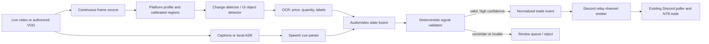

# Stream Signal Vision

**A modular audio-visual research prototype for recognizing trade events shown on livestreams.** It aims to turn a visible, verified position/level change into a validated event and post that event into the existing Discord relay channel. The current repository is a tested foundation with offline VLM/ASR-assisted labeling tools—not a trained live detector or a live trading application.

Target interfaces under investigation: **TopstepX** (the Topstep platform), **TradingView**, **Tradovate**, **WealthCharts**, and **MetaTrader 5**. One pooled detector learns universal chart concepts; thin profiles calibrate layout, crop, and price-axis mapping. This project does not claim zero-shot accuracy on every screen.

## Why this project

Some traders communicate through what they do on stream rather than explicit text alerts. A viewer may see an entry marker appear, quantity change, or stop/target line move. This project explores how to detect those visual state transitions, extract the displayed levels, validate them, and emit a normalized signal.

The intended downstream contract is a canonical trade message posted to the existing Discord relay channel; its already-built poller feeds NT8. The local webhook adapter remains a development/test sink. This repository deliberately contains no private Discord credentials, account configuration, provider screenshots, or order-execution code.

## Current status

- **Implemented and tested:** signal schema, trade-level validation, multi-frame confirmation/deduplication, VLM-assisted frame labeling, timestamped faster-whisper transcription/cue tagging, speech-cued sparse frame extraction, and review timeline tooling.
- **Visual prototype trained locally:** a pretrained YOLO image classifier distinguishes `open` from `not_open` on owner-verified temporal labels. Its weights and private frames are ignored by Git; this is not yet the UI-element detector. The fine-tuned weights are published: **[trade-state-classifier on Hugging Face](https://huggingface.co/Reaver1000/trade-state-classifier)** (model card documents the Whisper/VLM labeling flywheel and temporal-validation results).
- **Not yet implemented:** continuous live stream/audio capture, the universal entry/stop/target/order-ticket detector, OCR integration, live chunked ASR-to-video fusion, or production Discord emitter. The current Whisper script transcribes local VODs offline.
- **No claim of automatic trade accuracy is made.** Visual recognition must be measured on consented, labelled data before it can drive execution.

## Architecture



Recommended recognition strategy: process continuous video, use frame differencing to focus expensive visual work, and use timestamped speech cues to prioritize likely event windows. Detect universal entry/stop/target and position-state elements, OCR displayed numbers, and derive entry/modify/exit from consecutive state transitions. A pending order is not a trade. Whisper cues and VLM labels may propose evidence, but deterministic validation must reject impossible geometry and low-confidence reads.

## Quick start: tested core

Python 3.11+; no third-party dependencies are needed for the core tests.

```powershell
python -m unittest discover -s tests -v
```

The capture, dataset-preparation, and training workflow is documented in
[`docs/TRAINING_GUIDE.md`](docs/TRAINING_GUIDE.md). No model is trained or
bundled yet; platform-specific permissioned frames are a required input.

Optional development extras:

```powershell
pip install -e ".[capture,ocr,stream,audio-asr,test]"
```

Heavy vision packages are optional so the domain logic and tests stay fast and portable.

## Platform profiles

`configs/platform_profiles.example.json` lists the intended adapters. Region coordinates are normalized (0–1) relative to the capture size and are intentionally left uncalibrated: a streamer can crop, resize, theme, or rearrange any platform. A user profile must identify chart, order/position panel, and relevant order annotations for that specific layout.

Topstep is a prop firm; the visual adapter target is **TopstepX**. TradingView and Tradovate may be streamed as browser/desktop UIs. WealthCharts and MT5 need calibrated profiles and representative examples, but use the same pooled detector and class set.

## Output contract

An accepted event is a `SignalCandidate` containing source/platform, timestamp, action, trade state, direction, instrument, market/limit type, entry, stop, targets, displayed quantity, confidence, and evidence references. The production sink posts its canonical form to the Discord relay channel; the vision component does not choose account risk or position size, which remain downstream account-local controls.

## Safety and data policy

- This repository contains **no real stream captures or signal-provider content**. Only synthetic unit-test data belongs here.
- Capture only streams/screens you have permission to process. Public visibility is not the same as permission to redistribute or commercially exploit someone's stream content.
- Low confidence, missing levels, invalid stop/target geometry, or unstable frame transitions must yield **no trade event**.
- The initial deliverable is a portfolio/research prototype. It does not place orders and makes no profit or accuracy claims.
- No licence is granted yet; all rights reserved pending a commercial/licensing decision.

## Research snapshot (17 October 2026)

The GitHub searches found no maintained project dedicated to “watch a trader's stream → recognize order events → emit follower trades.” Adjacent reusable work exists:

- [Baivaras/poker-data-scraper](https://github.com/Baivaras/poker-data-scraper) — real-time screen capture, OCR, neural object detection, per-layout regions, labelling utilities, and tests. A useful architecture reference (different domain).
- [wolfmanstout/screen-ocr](https://github.com/wolfmanstout/screen-ocr) — screen-region OCR with selectable backends; Apache-2.0. Check each dependency's licence before bundling.
- [PaddleOCR](https://github.com/PaddlePaddle/PaddleOCR) — text detection + recognition pipelines; relevant for small price/quantity labels.
- [Ultralytics YOLO documentation](https://docs.ultralytics.com/) — custom object detection, tracking, and model export. **Review AGPL/commercial licensing before using Ultralytics in a closed-source paid product.**
- [OpenAI vision guide](https://developers.openai.com/api/docs/guides/images-vision) and [Structured Outputs](https://developers.openai.com/api/docs/guides/structured-outputs) — useful for optional ambiguity resolution with schema-constrained output; per-frame cloud vision is too costly/slow for continuous processing.
- [NormCap](https://github.com/dynobo/normcap) — mature screen OCR UX reference; GPL-3.0, so do not copy/bundle code in a proprietary product without licensing review.

See [`docs/RESEARCH.md`](docs/RESEARCH.md) for the full findings and source links.

## Project documents

- [`docs/PRODUCT_PLAN.md`](docs/PRODUCT_PLAN.md) — requirements, scope, risk, roadmap
- [`docs/ARCHITECTURE.md`](docs/ARCHITECTURE.md) — UML/component/sequence/state diagrams
- [`docs/DATASET_AND_EVALUATION.md`](docs/DATASET_AND_EVALUATION.md) — labelling and evaluation plan
- [`docs/RESEARCH.md`](docs/RESEARCH.md) — GitHub/model research and licensing notes
- [`docs/TRAINING_GUIDE.md`](docs/TRAINING_GUIDE.md) — capture, annotation, session split, and training workflow
- [`docs/CO_DEVELOPER_TRAINING.md`](docs/CO_DEVELOPER_TRAINING.md) — reproducible local setup, state intervals, classifier training, and inference

## Roadmap

1. Verify speech-cued position transitions against a fresh held-out VOD; use those as initial ground truth.
2. Label universal entry/stop/target/quantity and `open`/`pending`/`flat` state across the available sessions.
3. Train one pooled detector and measure session-held-out event accuracy.
4. Add OCR and asset-class price-range confluence; reject uncertain events.
5. Run continuous-video replay in dry-run and post only verified canonical events to the relay channel.
6. Add further platform calibrations and VODs without forking platform-specific models.
