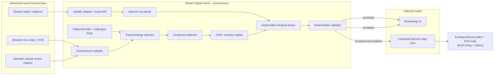
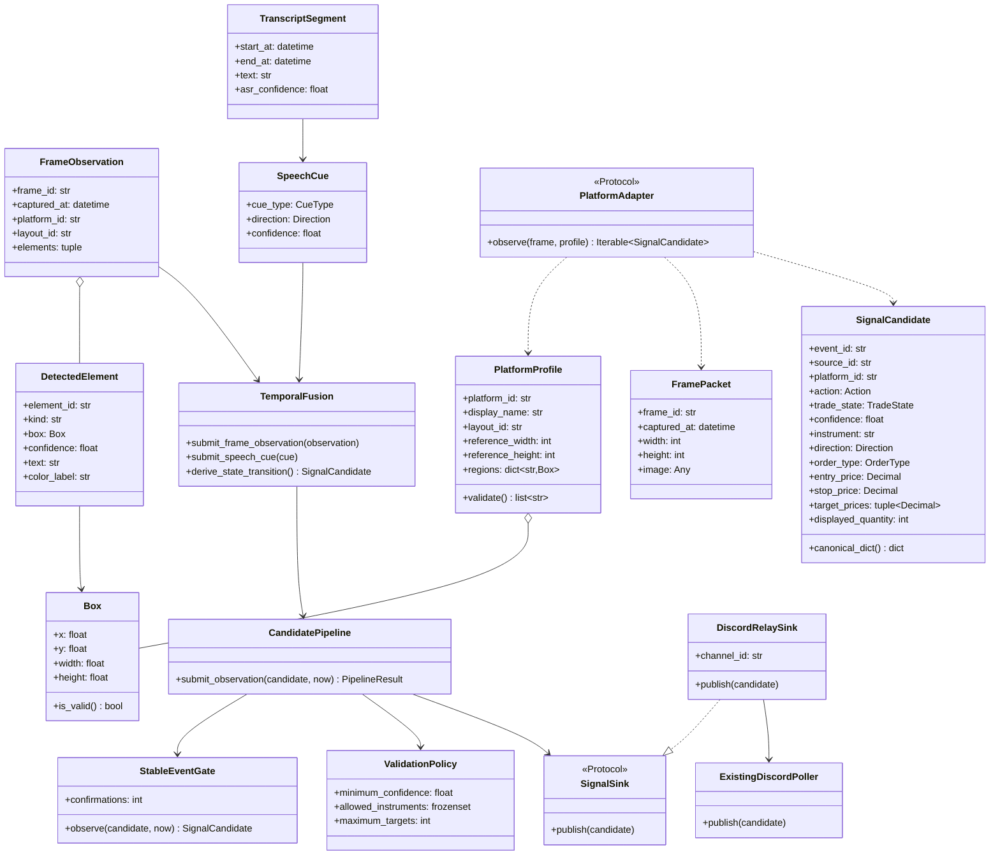
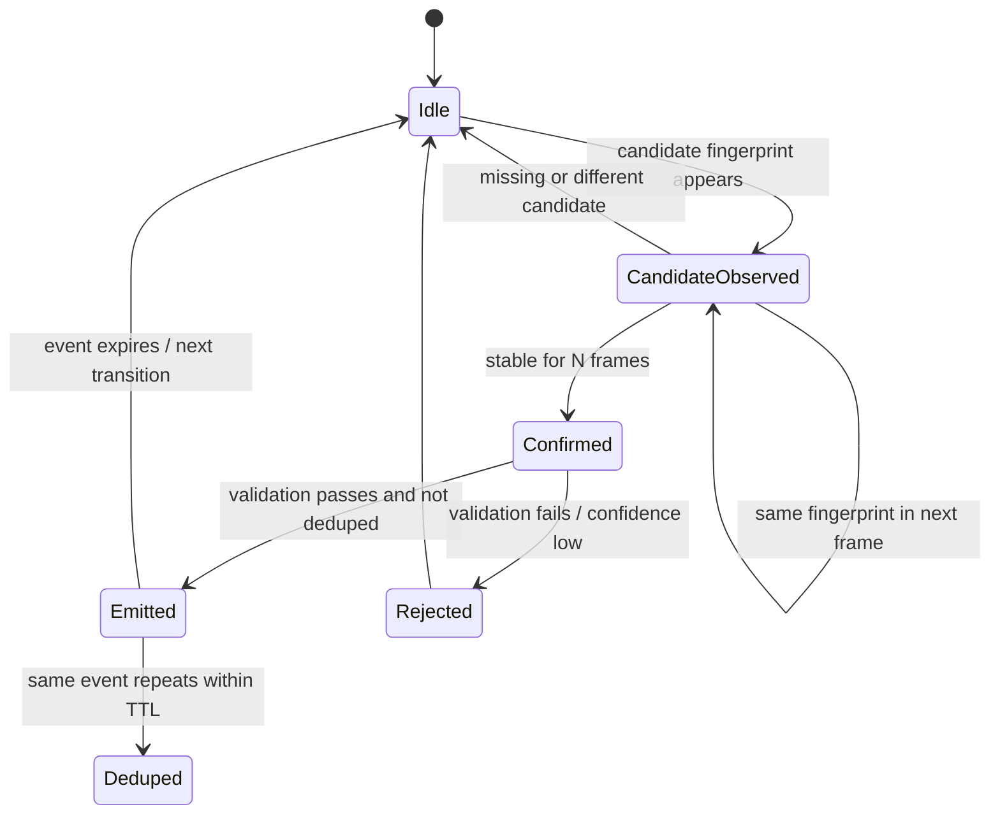

# Architecture and UML

## 1. System context



## 2. Component responsibilities

| Component | Responsibility | Deliberately does not do |
|---|---|---|
| `FrameSource` | Supplies timestamped frames from an authorized source | Interpret trades |
| `CaptionSource` / `ASR` | Supplies timestamped transcript segments; prefers captions, falls back to local speech recognition | Declare a trade from words alone |
| `SpeechCueParser` | Tags entry/position, stop/target update, and exit utterances | Supply missing prices or quantity |
| `PlatformProfile` | Names UI family/layout and normalized regions | Assume fixed pixel coordinates across streamers |
| `ChangeDetector` | Detects visual changes and chooses frames for deeper inspection | Decide direction/price |
| `PlatformAdapter` | Detects entry/stop/target/quantity UI elements and separates order tickets from filled-position evidence | Place orders |
| `TextRecognizer` | Reads visible price/quantity labels with confidence | Fill in missing values |
| `StableEventGate` | Requires consecutive observations; deduplicates repeat frames | Size positions |
| `TemporalFusion` | Matches audio cues with visual state changes on a shared clock; derives entry/modify/exit transitions | Treat a pending order as a filled position |
| `validate_candidate` | Enforces event schema, confidence, stop/target geometry | Predict market direction |
| `SignalSink` | Emits validated canonical event to review log or Discord relay channel | Hold broker credentials or submit orders |
| NT8 node (existing) | Per-account sizing, orders, bracket/reconciliation | Capture streams or host a cloud router |

## 3. Class diagram



## 4. Sequence: frame transition to candidate event

```mermaid
sequenceDiagram
    autonumber
    participant S as FrameSource
    participant A as Captions / ASR
    participant P as SpeechCueParser
    participant C as ChangeDetector
    participant D as PlatformAdapter
    participant O as OCR
    participant F as TemporalFusion / StateMachine
    participant V as Validator
    participant H as Review / DiscordRelaySink
    participant N as Existing NT8 Poller

    A->>P: TranscriptSegment (timestamp, text)
    P->>F: SpeechCue (position/entry/modify/exit claim)
    S->>C: FramePacket (timestamp, pixels; continuous video)
    C->>C: compare ROI to prior frame
    alt no meaningful change
        C-->>S: skip expensive inference
    else possible trade-state change
        C->>D: inspect frame + universal classes / calibrated regions
        D->>D: classify state: open / pending / flat / unknown
        D->>O: OCR numeric labels + boxes
        O-->>D: text + per-field confidence
        D-->>F: FrameObservation (state + elements + values)
        F->>F: match speech cue; derive state/level transition; dedupe
        F-->>V: candidate (open only with visual fill evidence)
        V->>V: confidence + numeric + direction/level checks
        alt valid and confidence sufficient
            V-->>H: accepted canonical event + evidence refs
            H->>N: post to Discord relay channel
            N->>N: existing relay executes via NT8
        else uncertain / inconsistent
            V-->>H: reject or request human review; no Discord post
        end
    end
```

## 5. State machines

### Candidate transition gate



### Trade event lifecycle (vision side)


## 6. Platform adapter strategy

The five named targets are profile families, not a claim of universal
compatibility:

| Profile id | Target | Likely visual anchors (to validate from authorized examples) |
|---|---|---|
| `topstepx` | TopstepX (Topstep platform) | chart/order panel, position quantity, order lines |
| `tradingview` | TradingView chart / broker panel | colored position tool, order labels, price scale |
| `tradovate` | Tradovate | DOM/ladder, working orders, position panel |
| `wealthcharts` | WealthCharts | chart annotations, position/order panel |
| `mt5` | MetaTrader 5 | chart trade levels, terminal trade tab, volume |

Each streamer needs a calibrated profile (ROIs, scaling, theme, stream crop).
Common detection is shared; layout-specific anchoring is not. The example
profile file intentionally has empty regions until a real, permissioned layout
is calibrated.
