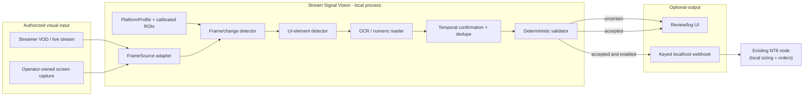
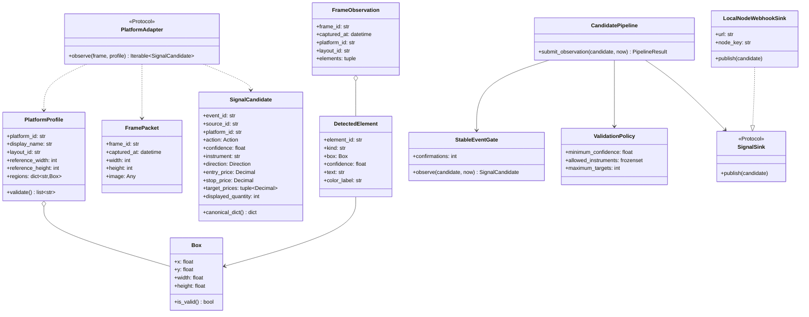
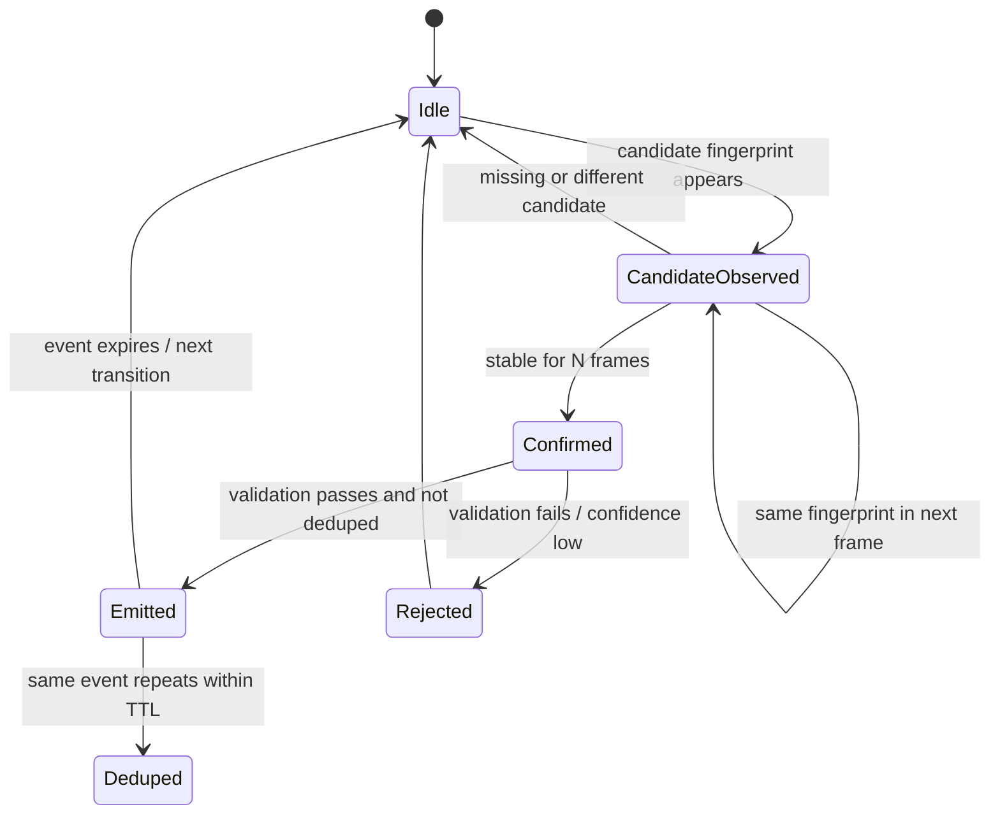
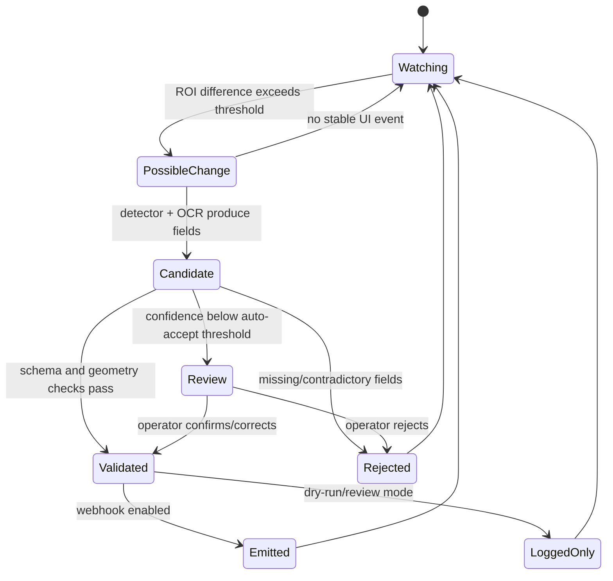

# Architecture and UML

## 1. System context



## 2. Component responsibilities

| Component | Responsibility | Deliberately does not do |
|---|---|---|
| `FrameSource` | Supplies timestamped frames from an authorized source | Interpret trades |
| `PlatformProfile` | Names UI family/layout and normalized regions | Assume fixed pixel coordinates across streamers |
| `ChangeDetector` | Detects visual changes and chooses frames for deeper inspection | Decide direction/price |
| `PlatformAdapter` | Detects entry/stop/target/quantity UI elements | Place orders |
| `TextRecognizer` | Reads visible price/quantity labels with confidence | Fill in missing values |
| `StableEventGate` | Requires consecutive observations; deduplicates repeat frames | Size positions |
| `validate_candidate` | Enforces event schema, confidence, stop/target geometry | Predict market direction |
| `SignalSink` | Emits validated event to review log or keyed local webhook | Hold broker credentials |
| NT8 node (existing) | Per-account sizing, orders, bracket/reconciliation | Capture streams or host a cloud router |

## 3. Class diagram



## 4. Sequence: frame transition to candidate event

```mermaid
sequenceDiagram
    autonumber
    participant S as FrameSource
    participant C as ChangeDetector
    participant A as PlatformAdapter
    participant O as OCR
    participant G as StableEventGate
    participant V as Validator
    participant H as HumanReview / SignalSink

    S->>C: FramePacket (timestamp, pixels)
    C->>C: compare ROI to prior frame
    alt no meaningful change
        C-->>S: skip expensive inference
    else possible trade-state change
        C->>A: inspect frame + calibrated PlatformProfile
        A->>A: locate entry/stop/target/quantity UI elements
        A->>O: OCR numeric labels + boxes
        O-->>A: text + per-field confidence
        A-->>G: SignalCandidate (event fingerprint)
        G->>G: require N stable frames; dedupe event_id
        G-->>V: confirmed candidate
        V->>V: confidence + numeric + direction/level checks
        alt valid and confidence sufficient
            V-->>H: accepted candidate + evidence refs
        else uncertain / inconsistent
            V-->>H: reject or request human review; no webhook
        end
    end
```

## 5. State machines

### Candidate transition gate



### Trade event lifecycle (vision side)



## 6. Platform adapter strategy

The five named targets are profile families, not a claim of universal
compatibility:

| Profile id | Target | Likely visual anchors (to validate from authorized examples) |
|---|---|---|
| `topstepx` | TopstepX (Topstep platform) | chart/order panel, position quantity, order lines |
| `tradingview` | TradingView chart / broker panel | colored position tool, order labels, price scale |
| `tradovate` | Tradovate | DOM/ladder, working orders, position panel |
| `wealthcharts` | WealthCharts | chart annotations, position/order panel |
| `mt5` | MetaTrader 5 | chart trade levels, terminal trade tab, volume |

Each streamer needs a calibrated profile (ROIs, scaling, theme, stream crop).
Common detection is shared; layout-specific anchoring is not. The example
profile file intentionally has empty regions until a real, permissioned layout
is calibrated.
